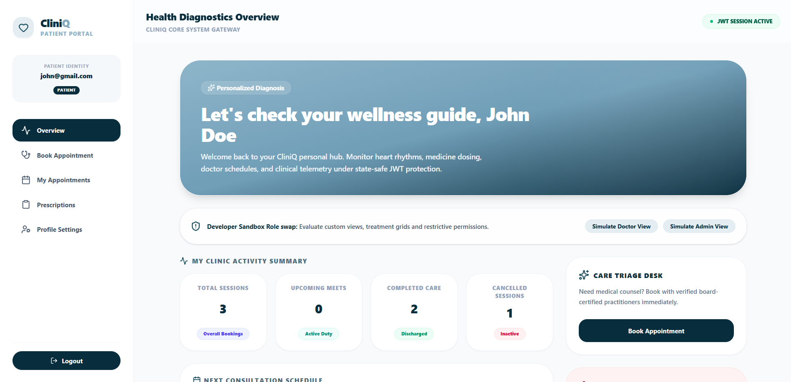
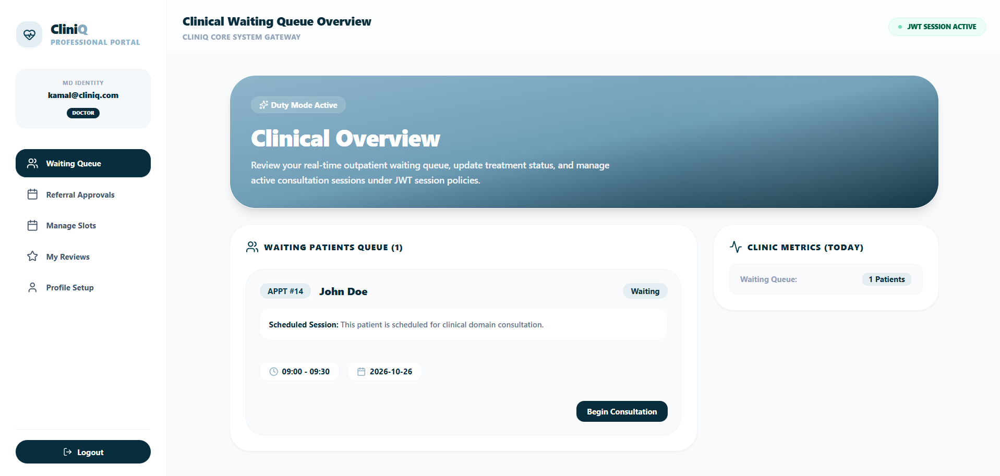
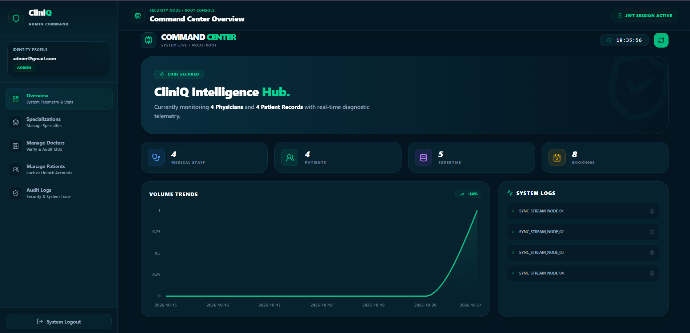
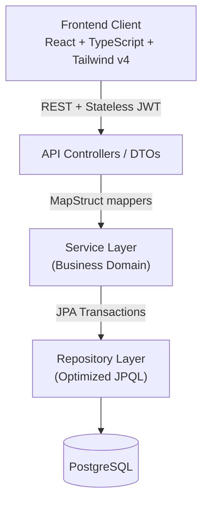
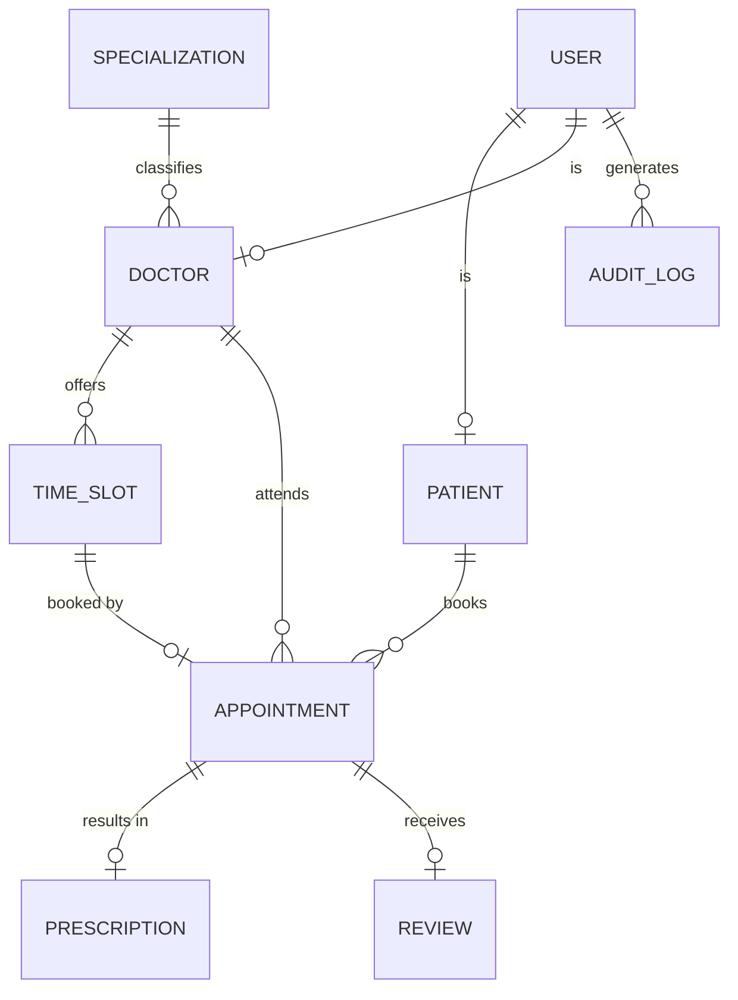

## 📖 Overview
 
**CliniQ** streamlines the full outpatient workflow: patients discover doctors and book time slots, doctors manage availability and issue e-prescriptions, and administrators monitor and govern the entire platform from a single command center.
 
It is built on **Clean Layered Architecture**, **stateless JWT security**, and **optimized database access** (N+1 elimination, read-only transactions, constraint-backed concurrency protection).
 
> 📸 **Screenshots** — add images to a `docs/screenshots/` folder and reference them here:
>
> | Patient Portal | Doctor Portal | Admin Dashboard |
> | :---: | :---: | :---: |
> |  |  |  |
 
---
 
## ✨ Features
 
### 🩺 Patient Portal
- **Doctor Discovery** — Search doctors by specialization and name.
- **Time Slot Booking** — Date-driven slot picker with double-booking prevention.
- **Smart Cancellation** — 24-hour advance cancellation rule; slots are freed automatically.
- **Consultation History** — Track past and upcoming appointments.
- **Verified Reviews** — Submit 1–5 star ratings and feedback for completed consultations.
- **Digital Prescriptions** — View diagnosis and dosage details, and download as a vector PDF (`jsPDF`).
### 👨‍⚕️ Doctor Portal
- **Availability Management** — Bulk-generate weekly slots based on consultation duration.
- **Consultation Workspace** — Queue of confirmed patients with a completion workflow.
- **E-Prescriptions** — Record diagnosis notes and issue structured medication dosages.
- **Performance Insights** — Review archive with automatic average rating calculation.
### 🛡️ Admin Command Center (“Emerald Command” UI)
- **Live Telemetry** — Totals for medical staff, patients, specializations, and bookings.
- **7-Day Trend Chart** — Daily booking volume with zero-gap calendar normalization.
- **User Governance** — Instant Active/Inactive toggles and soft deletes via bulk JPA queries.
- **System Audit Logs** — Searchable, filterable trail of platform actions: `SECURITY`, `BOOKING`, `PRESCRIPTION`, `REVIEW`, `PROFILE`.
---
 
## 🏛 Architecture
 
CliniQ follows a strict layered architecture with a unidirectional dependency flow.
 

 
### ⚡ Engineering Highlights
 
| Area | Implementation |
| :--- | :--- |
| **N+1 Elimination** | Explicit JPQL `JOIN FETCH` (and `LEFT JOIN FETCH` for nullable slots) for single-query loading across `Appointment → Patient → Doctor → Specialization → TimeSlot`. |
| **Stateless Security** | JWT access/refresh tokens with refresh rotation, plus an Axios interceptor for transparent auto-refresh and public-route bypass. |
| **Concurrency Safety** | Unique constraint on `Appointment → TimeSlot` prevents race conditions and double-booking at the database level. |
| **Read Optimization** | `@Transactional(readOnly = true)` on read paths to skip dirty-check snapshots and reduce memory overhead. |
| **Scheduled Cleanup** | `@Scheduled(cron = "0 0 0 * * SUN")` removes past unbooked slots every Sunday at midnight while preserving booked records. |
| **Async Audit Logging** | Centralized audit service records user identity, action, and timestamp into indexed tables without blocking core transactions. |
 
---
 
## 🛠 Tech Stack
 
| Layer | Technologies |
| :--- | :--- |
| **Backend** | Java 17, Spring Boot 3.5.x, Spring Data JPA, Hibernate, Spring Security, MapStruct 1.5.5, Lombok |
| **Frontend** | React, TypeScript, Tailwind CSS v4, Lucide Icons, Framer Motion, Axios |
| **Database** | PostgreSQL 15+ (indexed queries, unique constraints) |
| **Testing** | JUnit 5, Mockito |
| **Docs & Logging** | Springdoc OpenAPI 3 (Swagger UI), SLF4J / Logback (daily rolling logs) |
| **Tooling** | Maven, Vite, npm, Git |
 
---
 
## 🗄 Database Schema
 
Simplified entity relationships (adjust to match your final entity model):
 

 
---
 
## 🚀 Getting Started
 
### Prerequisites
 
| Tool | Version |
| :--- | :--- |
| JDK | 17+ |
| Node.js & npm | 18+ |
| PostgreSQL | 15+ (running locally) |
| Maven | 3.8+ |
 
### 1. Clone the repository
 
```bash
git clone https://github.com/Lahiru075/doctor-appointment-system.git
cd doctor-appointment-system
```
 
### 2. Create the database
 
```sql
CREATE DATABASE doctor_appointment_db;
```
 
### 3. Run the backend (Spring Boot)
 
```bash
cd doctor_appointment_system_be
 
# Create your local config from the template
cp src/main/resources/application.properties.example src/main/resources/application.properties
 
# Edit application.properties with your DB credentials and JWT secrets, then:
mvn clean spring-boot:run
```
 
- API: `http://localhost:8080`
- Swagger UI: `http://localhost:8080/swagger-ui/index.html`
### 4. Run the frontend (React + Vite)
 
```bash
cd doctor_appointment_system_fe
npm install
npm run dev
```
 
- App: `http://localhost:5173`
---
 
## ⚙️ Configuration
 
Create `application.properties` from `application.properties.example`:
 
```properties
# Database
spring.datasource.url=jdbc:postgresql://localhost:5432/doctor_appointment_db
spring.datasource.username=postgres
spring.datasource.password=your_password
spring.datasource.driver-class-name=org.postgresql.Driver
 
# JPA & Hibernate
spring.jpa.hibernate.ddl-auto=update
spring.jpa.show-sql=true
spring.jpa.open-in-view=false
 
# JWT (HMAC-SHA256, Base64-encoded 256-bit keys)
jwt.expiration=900000
jwt.secretKey=your_base64_secret_key_here
jwt.refreshExpiration=604800000
jwt.refreshSecretKey=your_base64_refresh_secret_key_here
 
# Logging
logging.level.root=INFO
logging.level.com.example.doctor_appointment_system_be=DEBUG
logging.file.name=logs/cliniq.log
```
 
> [!WARNING]
> - Never commit `application.properties` — keep it in `.gitignore`.
> - Generate strong, unique JWT secrets (e.g. `openssl rand -base64 32`).
> - `ddl-auto=update` and `show-sql=true` are for **development only**. Use `validate` with a migration tool (Flyway/Liquibase) and disable SQL logging in production.
 
---
 
## 🔒 API Reference
 
All protected endpoints require `Authorization: Bearer <access_token>`.
 
| Module | Method | Endpoint | Role | Description |
| :--- | :---: | :--- | :---: | :--- |
| **Auth** | `POST` | `/api/v1/auth/register` | Public | Register a patient account |
| | `POST` | `/api/v1/auth/login` | Public | Authenticate and obtain JWT tokens |
| | `POST` | `/api/v1/auth/refresh` | Public | Get a new access token via refresh token |
| **Patient** | `GET` | `/api/v1/patient/doctors` | Patient | Search doctors by name & specialization |
| | `POST` | `/api/v1/appointments/book` | Patient | Book a consultation slot |
| | `PUT` | `/api/v1/appointments/cancel/{id}` | Patient | Cancel appointment (24h rule) |
| | `POST` | `/api/v1/reviews` | Patient | Submit a 1–5 star review |
| **Doctor** | `POST` | `/api/v1/doctor/schedule/weekly` | Doctor | Bulk-generate weekly slots |
| | `PUT` | `/api/v1/appointments/complete/{id}` | Doctor | Mark consultation as complete |
| | `POST` | `/api/v1/prescriptions` | Doctor | Issue an e-prescription |
| **Admin** | `GET` | `/api/v1/admin/dashboard/stats` | Admin | Real-time stats & 7-day trends |
| | `GET` | `/api/v1/admin/audit-logs` | Admin | Query system audit trail |
| | `PUT` | `/api/v1/admin/doctors/{id}/status` | Admin | Toggle doctor active status |
 
Full interactive docs: [Swagger UI](http://localhost:8080/swagger-ui/index.html) • [OpenAPI JSON](http://localhost:8080/v3/api-docs)
 
---
 
## 🧪 Testing
 
Unit tests (JUnit 5 + Mockito) cover core business rules: double-booking prevention, 24-hour cancellation, duplicate registration conflicts, and credential validation.
 
```bash
# Run all tests
mvn clean test
 
# Run a specific suite
mvn test -Dtest=AppointmentServiceTest
mvn test -Dtest=AuthServiceTest
```
 
---
 
## 📁 Project Structure
 
```
doctor-appointment-system/
├── doctor_appointment_system_be/   # Spring Boot backend
└── doctor_appointment_system_fe/   # React + TypeScript frontend
```
 
---
 
## 🗺 Roadmap
 
- [ ] Email / SMS appointment reminders
- [ ] Online payment integration
- [ ] Dockerized setup (`docker-compose`)
- [ ] CI/CD pipeline (GitHub Actions)
- [ ] Integration tests with Testcontainers
---
 
## 🤝 Contributing
 
Contributions are welcome!
 
1. Fork the repository
2. Create a feature branch: `git checkout -b feature/your-feature`
3. Commit using [Conventional Commits](https://www.conventionalcommits.org/): `git commit -m "feat: add your feature"`
4. Push the branch: `git push origin feature/your-feature`
5. Open a Pull Request
---
 
## 📄 License
 
Distributed under the **MIT License**. See [`LICENSE`](LICENSE) for details.
 
---
 
## 👤 Author
 
**Lahiru** — [@Lahiru075](https://github.com/Lahiru075)
 
<div align="center">
⭐ If you found this project useful, consider giving it a star!
 
</div>
